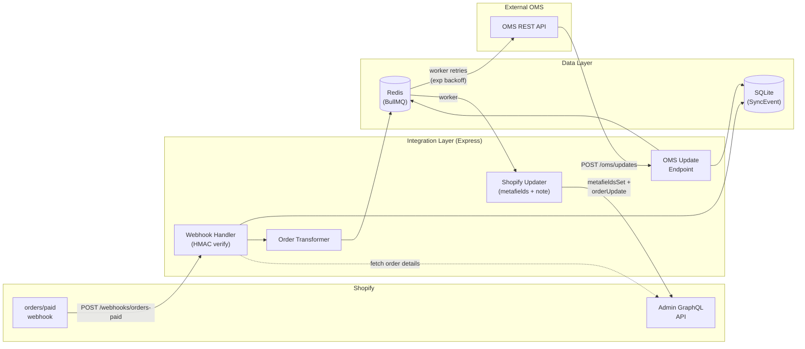

# Shopify ↔ OMS Integration

## Architecture



The Express integration accepts Shopify webhooks and OMS updates. Shopify deliveries are acknowledged quickly (within 5 s) and processed asynchronously by BullMQ workers. The mock OMS is a separate Express server on port 3001.

## Technical decisions

- GraphQL is used for Shopify order retrieval and updates.
- Metafields store the external OMS ID and status; an append-only order-note line provides merchant-visible context.
- SQLite/Prisma provides a lightweight demo database. BullMQ/Redis provides durable jobs and retries.
- Shopify order IDs are the cross-system business key. OMS writes use `X-Idempotency-Key` with that ID.
- Redis is required in this implementation. Start it with `docker compose up -d redis`.

## Data model

`SyncEvent` stores:

- Shopify and OMS identifiers
- webhook ID and synchronization direction
- status and retry/error information
- original payload and timestamps

The unique `webhookId` column prevents duplicate Shopify deliveries and duplicate OMS callback events. SQLite is appropriate for the demo; PostgreSQL is the production replacement.

## Reliability

- Shopify webhook HMAC-SHA256 verification is required before processing.
- The Shopify webhook ID is stored once atomically in SQLite. BullMQ also uses a deterministic job ID.
- OMS 500 responses and network failures are retried with exponential backoff.
- OMS order creation is protected by both a lookup and `X-Idempotency-Key`.
- OMS callback duplicate deliveries are deduplicated using a deterministic external-order/status key.
- Replays, restarts, and prolonged OMS downtime remain in Redis; a failed sync is retained as a database audit record.
- Real infrastructure should retain Redis and the database, run workers separately from public web processes, and alert on dead-lettered jobs.

## Scaling

At roughly 100 orders/day, SQLite plus a small Redis instance and one worker is sufficient. At 10,000/day:

- use PostgreSQL and managed Redis
- run multiple worker instances and separate Shopify/OMS queues
- use queue concurrency and OMS-specific throughput limits
- use GraphQL cost-aware throttling and batch/bulk operations where appropriate
- partition and retain sync-event data with a retention policy
- use metrics, traces, dead-letter queues, and horizontal replicas behind a load balancer

## Security

- Verify Shopify webhook HMAC signatures against the raw JSON body.
- Store Shopify, OMS, Redis, and database secrets in the environment or a secret manager.
- Send OMS API keys as bearer credentials and validate OMS callback requests.
- Keep a private OMS callback endpoint behind TLS, allowlisting, signatures, or mTLS where possible.
- Do not expose the sync-status endpoint publicly in production; require authentication or remove it.
- Restrict CORS and apply rate limiting, request-size limits, and structured redaction.

## Production improvements

- replace SQLite with PostgreSQL and add migrations
- replace environment-only configuration checks with startup validation
- add a persistent OMS inbox/outbox and circuit breaker
- add signed OMS callbacks and replay protection
- add GraphQL bulk query support and token refresh/secrets rotation
- add DLQ replay tooling and dashboards
- run integration and contract tests in CI

## Quick Start

```bash
# 1. Install dependencies
npm install

# 2. Start Redis (requires Docker)
docker compose up -d redis

# 3. Copy and configure environment
cp .env.example .env
# Edit .env with your Shopify and OMS credentials

# 4. Set up the database
npx prisma db push

# 5. Start the mock OMS (terminal 1)
npm run dev:oms

# 6. Start the integration server (terminal 2)
npm run dev
```

The integration server runs on `http://localhost:3000` and the mock OMS on `http://localhost:3001`.

## Testing & Webhook Registration

### 1. Test Shopify API Connection
Verify that your Shopify credentials in `.env` are valid:
```bash
npm run test:shopify
```

### 2. End-to-End Simulation (Local Test)
You don't need a public tunnel to test the complete integration flow. With the integration server and mock OMS running:
```bash
npm run simulate
```
This script automatically:
- Signs a mock `orders/paid` webhook payload with your `SHOPIFY_WEBHOOK_SECRET`
- Submits it to `POST /webhooks/orders-paid`
- Re-sends the exact same webhook to prove **idempotency & duplicate rejection**
- Submits an OMS status update to `POST /oms/updates` with Bearer auth
- Queries `GET /oms/sync-status/:orderId` to display the database audit records

### 3. Registering Real Webhooks in Shopify
To receive real webhook events from a Shopify store, Shopify requires a **public HTTPS URL** (it cannot deliver to `localhost`).

1. Expose your local port 3000 using a tunnel (e.g., [ngrok](https://ngrok.com/) or Cloudflare Tunnel):
   ```bash
   ngrok http 3000
   ```
2. Register the webhook via GraphQL script:
   ```bash
   npm run register:webhook https://<your-ngrok-domain>.ngrok-free.app/webhooks/orders-paid
   ```
   *(Alternatively, configure it in Shopify Admin under **Settings** → **Notifications** → **Webhooks**).*

