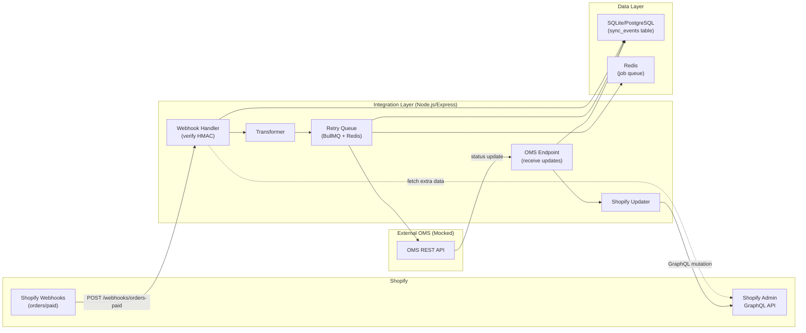

# Shopify ↔ OMS Integration Layer — Implementation Plan

## Assessment Summary

Build an integration layer between **Shopify** and an external **Order Management System (OMS)** with two flows:
1. **Shopify → OMS**: Capture paid-order webhooks, transform, and send to OMS
2. **OMS → Shopify**: Receive OMS status updates and sync back to Shopify

---

## Architecture Overview



## Tech Stack

| Component | Choice | Reason |
|-----------|--------|--------|
| Runtime | Node.js + TypeScript | Required by assessment |
| Framework | Express.js | Simple, widely understood |
| Shopify API | Admin GraphQL API (`@shopify/shopify-api`) | Required by assessment |
| Job Queue | BullMQ + Redis | Reliable retry, dead-letter, rate limiting |
| Database | SQLite (via Prisma) | Easy setup, sufficient for demo; Prisma makes switching to PostgreSQL trivial |
| Mock OMS | Express REST endpoints | Simple mock server on separate port |

## Project Structure

```
shopify-oms-integration/
├── prisma/
│   └── schema.prisma          # Data model
├── src/
│   ├── config/
│   │   └── index.ts           # Env vars, constants
│   ├── lib/
│   │   ├── shopify.ts         # Shopify client setup + GraphQL helpers
│   │   ├── queue.ts           # BullMQ queue setup
│   │   └── prisma.ts          # Prisma client singleton
│   ├── middleware/
│   │   └── webhookVerify.ts   # HMAC verification middleware
│   ├── routes/
│   │   ├── webhooks.ts        # POST /webhooks/orders-paid
│   │   └── omsUpdates.ts      # POST /oms/updates
│   ├── services/
│   │   ├── orderTransformer.ts # Shopify → OMS payload transform
│   │   ├── omsClient.ts       # Send orders to OMS API
│   │   └── shopifyUpdater.ts  # Update Shopify orders via GraphQL
│   ├── workers/
│   │   └── omsOrderWorker.ts  # BullMQ worker: process queued orders
│   ├── mock-oms/
│   │   └── server.ts          # Mocked OMS REST API
│   └── app.ts                 # Express app entry
├── .env.example
├── package.json
├── tsconfig.json
└── README.md
```

## Data Model (Prisma)

```prisma
model SyncEvent {
  id              String   @id @default(uuid())
  shopifyOrderId  String
  shopifyOrderGid String?
  omsOrderId      String?
  webhookId       String   @unique   // Shopify X-Shopify-Webhook-Id for idempotency
  direction       String              // "SHOPIFY_TO_OMS" | "OMS_TO_SHOPIFY"
  status          String              // "PENDING" | "PROCESSING" | "SYNCED" | "FAILED"
  payload         String              // JSON blob
  errorMessage    String?
  retryCount      Int      @default(0)
  createdAt       DateTime @default(now())
  updatedAt       DateTime @updatedAt

  @@index([shopifyOrderId])
  @@index([status])
}
```

## Key Scenarios Addressed

### 1. Duplicate Webhooks
- Use Shopify's `X-Shopify-Webhook-Id` header as a **unique key** in `SyncEvent.webhookId`
- Before processing, check if this webhook ID already exists → skip if found
- Database unique constraint provides a final safety net

### 2. OMS Failure (500 errors)
- Orders go into **BullMQ queue** with exponential backoff retry
- Config: 5 retries, backoff starting at 30s doubling each time
- Failed jobs move to a **dead-letter queue** for manual review

### 3. Extended Downtime
- BullMQ + Redis **persists jobs** even during OMS downtime
- Jobs automatically retry when OMS comes back
- In production: use a managed Redis (e.g., AWS ElastiCache) for durability

### 4. Partial Failure (OMS created order but app crashed before recording)
- **Idempotency key**: Send `shopify_order_id` as an idempotency key to OMS
- OMS uses this to deduplicate — if it already has order `123456789`, it returns the existing one
- On retry, check OMS for existing order before creating a new one

### 5. Shopify API Rate Limits
- Use `@shopify/shopify-api`'s built-in throttling
- BullMQ **rate limiter**: control concurrency (e.g., max 2 concurrent jobs)
- For high volume: batch GraphQL queries using `bulkOperationRunQuery`

### 6. Security
- **Webhook verification**: HMAC-SHA256 using `X-Shopify-Hmac-Sha256` header
- **Credentials**: All secrets in `.env`, never committed
- **OMS auth**: API key in `Authorization` header
- **Public endpoints**: Only `/webhooks/*` and `/oms/updates` exposed; validate all inputs

---

## Implementation Steps

| # | Task | Files |
|---|------|-------|
| 1 | Project scaffolding (package.json, tsconfig, Prisma) | config files |
| 2 | Prisma schema + SQLite setup | `prisma/schema.prisma` |
| 3 | Config module (env vars) | `src/config/index.ts` |
| 4 | Shopify client + GraphQL queries | `src/lib/shopify.ts` |
| 5 | Webhook HMAC verification middleware | `src/middleware/webhookVerify.ts` |
| 6 | Order transformer (Shopify → OMS format) | `src/services/orderTransformer.ts` |
| 7 | BullMQ queue + worker setup | `src/lib/queue.ts`, `src/workers/omsOrderWorker.ts` |
| 8 | OMS client (send orders) | `src/services/omsClient.ts` |
| 9 | Webhook route (POST /webhooks/orders-paid) | `src/routes/webhooks.ts` |
| 10 | OMS update endpoint + Shopify updater | `src/routes/omsUpdates.ts`, `src/services/shopifyUpdater.ts` |
| 11 | Mock OMS server | `src/mock-oms/server.ts` |
| 12 | Express app wiring | `src/app.ts` |
| 13 | README with all required sections | `README.md` |
